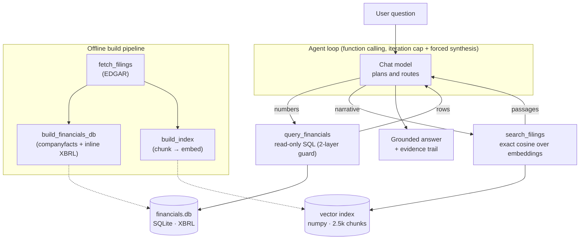

# Filing Analyst

**An agentic RAG analyst for SEC 10-K filings.** Ask a question about NVIDIA, AMD, or Intel and it routes to the right tool — SQL for exact numbers, semantic search over the filing text for narrative, or both — then returns a grounded answer with a full evidence trail: the exact SQL it ran and the filing sections it cited.

> _Covers **NVIDIA (NVDA), AMD, Intel (INTC)** — the two most recent annual 10-Ks for each, plus a few years of financial history from SEC XBRL data._

The web UI and the CLI both **stream the agent's trace** — you watch it route between SQL and the filings, see the exact query it ran and where the data came from, then read the grounded answer.

<!-- DEMO GIF PLACEHOLDER -->
<table><tr><td align="center" width="760">
<br>🎬 &nbsp; <b>Demo</b> &nbsp;·&nbsp; a screen recording of the live web trace goes here<br>
<sub>Run <code>make serve</code> to try it, then drop a recording at <code>docs/demo.gif</code> and
replace this block with <code></code>.</sub><br><br>
</td></tr></table>

Here's the same trace from the terminal (`python -m app.ask "…"`). Note the agent **recovering from a dead end** — its first query returns no rows, so it introspects the schema, finds the right member, and re-queries:

```text
┌─ Filing Analyst ────────────────────────────────────────────
│ What was NVIDIA's data-center revenue in FY2026 versus FY2025, and what does the filing attribute the change to?
└──────────────────────────────────────────────────────────────

▸  SQL  SQL query  →  financials.db (SEC XBRL)
    SELECT fiscal_year, period_end, member, value FROM segment_revenue
    WHERE ticker='NVDA' AND dimension='business_segment' AND member='Data Center' ...
    ✓ 0 rows

▸  SEARCH  Semantic search  →  10-K filings (vector index)
    "Data Center revenue increase AI infrastructure Blackwell accelerated computing"  [NVDA, FY2026]
    ✓ 5 passages   NVDA FY2026 · Item 7 · chunk 211 (0.67), Item 1 · chunk 27 (0.61) ...

plan  The segment query returned no rows — let me check the exact member names used for NVDA.

▸  SQL  SQL query  →  financials.db (SEC XBRL)
    SELECT DISTINCT dimension, member FROM segment_revenue WHERE ticker='NVDA' ...
    ✓ 14 rows   (business_segment / product / geography members)

▸  SQL  SQL query  →  financials.db (SEC XBRL)
    SELECT fiscal_year, period_end, member, value FROM segment_revenue
    WHERE ticker='NVDA' AND dimension='product' AND member='Data Center' ...
    ✓ 2 rows   FY2025 $115.186B · FY2026 $193.737B

── Answer ────────────────────────────────────────────────────────────
NVIDIA's Data Center revenue was $193.7B in FY2026, up 68% from $115.2B in FY2025.
The FY2026 10-K (Item 7) attributes it to the shift to accelerated computing and AI:
compute +59% on Blackwell demand, networking +142% on NVLink for GB200/GB300 — partly
offset by a $4.5B H20 inventory charge in Q1 FY2026.
──────────────────────────────────────────────────────────────────────
```

---

## Why it's built this way

A language model is great at *reading* a 10-K's risk factors but will happily hallucinate a revenue figure. A SQL database is exact but can't explain *why* revenue moved. So the agent does both:

> **Vectorize the fuzzy thing, query the exact thing.**

Every quantitative claim comes from a read-only SQL query against a database built from SEC's structured XBRL data; every qualitative claim is retrieved from the actual filing text and cited by section. The user sees both, so the answer is auditable rather than taken on faith.

## Architecture



The agent depends only on two tool functions and a `Retriever` protocol — not on numpy, SQLite, or any provider SDK directly — so the pieces swap independently.

## Quickstart

**Prerequisites:** Python 3.11+, a [Fireworks](https://fireworks.ai) API key (or any OpenAI-compatible provider), and an email for SEC's required User-Agent.

```bash
make install                 # create .venv and install dependencies
cp .env.example .env         # then edit: set SEC_USER_AGENT and FIREWORKS_API_KEY
make all                     # fetch filings → build DB → build vector index
make check                   # (optional) verify the provider + model ids resolve
make serve                   # chat UI at http://localhost:8000 (+ /dashboard)
```

Other targets: `make eval` (grade the agent), `make test` (unit tests), `make help` (list all). Prefer the terminal? Ask with a live trace:

```bash
.venv/bin/python -m app.ask "Which of NVIDIA, AMD, and Intel grew revenue fastest, and why?"
```

Or call the API directly:

```bash
curl -s localhost:8000/api/chat -H 'Content-Type: application/json' \
  -d '{"question":"What was NVIDIA'\''s gross margin in its latest fiscal year?"}'
# -> {"answer": "...", "evidence": [{"tool":"query_financials","sql":"SELECT ..."}, ...]}
```

Switching providers is config-only — no code changes. Set `LLM_BASE_URL`, `LLM_API_KEY`, `LLM_CHAT_MODEL`, and `LLM_EMBED_MODEL` in `.env` to point at OpenAI, Together, a local vLLM server, etc.

## Example

> **Q: How did NVIDIA's China (incl. Hong Kong) revenue change from FY2025 to FY2026, and what does the filing say about the dynamics there?**
>
> **NVIDIA's China (incl. Hong Kong) revenue grew ~15% in dollars but shrank sharply as a share of total revenue**, as U.S. export controls throttled what NVIDIA could sell into the market.
> - FY2025 **$17.108B** → FY2026 **$19.677B** (+$2.57B, **+15.0%**)
> - Share of total revenue: **13.1% → 9.1%** (China grew far slower than the +65% overall)
> - The FY2026 10-K ties this to an **H20 export-license requirement** (April 2025), a resulting **$4.5B inventory charge**, only ~$60M of licensed H20 sales, and a September 2025 antitrust probe by Chinese regulators.
>
> <sub>**Evidence** · 2 SQL queries (`segment_revenue`, `metrics`) + semantic search → NVDA FY2026 10-K Item 7, Item 1, Item 1A.</sub>

Note the fiscal-calendar alignment: NVIDIA's **FY2026 ends January 2026**, so it's compared against the right periods even though AMD and Intel label the same span "FY2025."

## Dashboard

Alongside the chat, `/dashboard` is a prebuilt analytics view straight from `financials.db` — revenue and gross-margin trends, R&D intensity, segment revenue, and geographic mix across all three companies. Charts are **server-rendered inline SVG** (no chart library, no CDN), theme-aware, with a data-table toggle under each. Colors use a CVD-validated categorical palette. It makes the fiscal-year and competitive story legible at a glance — e.g., NVIDIA's revenue line pulling away while Intel carries the highest R&D-to-revenue ratio. (Segment revenue is shown only where a company's segments form a clean partition; Intel's is omitted because its reported segment revenue includes large intersegment amounts.)

## Evaluation

18 questions across three categories, graded by `make eval`. Numeric gold answers are computed **from the database** (via stored SQL, never hand-typed); narrative and synthesis answers are graded by an LLM judge against a written gold answer; some use exact entity matching.

| Category | Description | Passed |
| --- | --- | --- |
| `lookup` | single exact figure (SQL only) | **7 / 7** |
| `narrative` | qualitative, from filing text | **6 / 6** |
| `synthesis` | multi-step / cross-company (both tools) | **5 / 5** |
| **Total** | | **18 / 18 (100%)** |

<sub>Run with `accounts/fireworks/models/kimi-k3` at temperature 0. Full per-question verdicts in [`eval/results/summary.md`](eval/results/summary.md); reproduce with `make eval`.</sub>

**Honest caveats on this number.** A 100% pass rate reflects a deliberately scoped eval set on a small, high-quality corpus — it is a sanity-and-regression harness, not a claim of universal accuracy. The numeric scorer uses a ±2% tolerance, and the LLM judge is itself a model and can be lenient; the written gold answers are my own. The value is in catching regressions and in the *evidence trail*, which lets you verify any single answer in seconds. See **Limitations** for known gaps.

## Design decisions & tradeoffs

- **Two tools, one router.** A function-calling loop (iteration cap + forced final synthesis so you always get an answer) decides per question whether to hit SQL, search, or both. No brittle keyword routing.
- **No LangChain, no vector DB.** For a few thousand chunks, exact cosine over a numpy matrix is one matrix-vector product per query — simpler, zero infra, and trivially correct. A `Retriever` protocol means swapping in FAISS/pgvector later is one new class and no agent changes.
- **Read-only SQL, enforced twice.** An OS-level `mode=ro` SQLite connection *and* a single-statement `SELECT`/`WITH` validator, plus a row cap. The exact SQL is echoed back as evidence.
- **Canonical metrics over raw XBRL tags.** Companies tag the same line item differently and migrate tags over time (NVIDIA's total-revenue tag moved from `RevenueFromContractWithCustomer…` to `Revenues`). The builder merges candidate tags per metric and keeps the latest-filed value per fiscal year, so the agent queries a clean `metric='revenue'` across all three companies.
- **Fiscal years are first-class.** NVIDIA's fiscal year ends in late January; AMD and Intel end in late December. Every period's exact end date is stored, and the agent is told to align on `period_end` rather than the FY label.
- **HTML filings → section citations.** Modern EDGAR 10-Ks are inline-XBRL HTML with no pages, so chunks are cited by 10-K item (e.g. *Item 1A*) plus a chunk ordinal — a more meaningful anchor than a synthetic page number.
- **Provider-agnostic.** The OpenAI SDK pointed at any OpenAI-compatible base URL; defaults target Fireworks but everything is overridable via env.

## Limitations & next steps

- **Table-aware chunking.** Financial tables lose structure in plain-text extraction; narrative sections (risks, MD&A, strategy) chunk cleanly, which is where search is used, but a table-aware chunker would help.
- **Segment data coverage.** Segment/geographic revenue is parsed from inline XBRL for the filing years only. `total_liabilities` is untagged by AMD/Intel (the agent derives it as assets − equity) and NVIDIA doesn't expose a clean `capex` tag — both are documented in the schema hint.
- **Segment members can nest.** A company's product/segment members may overlap (NVIDIA "Data Center" ⊇ "Compute" + "Networking") or include intersegment revenue; the schema warns the agent not to blind-sum them. Geography is a clean partition.
- **Eval is small and partly model-judged.** See the caveat above. Growing the set and adding a human-rated subset would strengthen it.
- **Single-turn.** No conversation memory; each question is answered fresh.

## Project layout

```
config.py                   provider client, model ids, shared embedder, paths
app/sql_tool.py             read-only text-to-SQL (two-layer guard + schema hint)
app/retriever.py            Retriever protocol + NumpyCosineRetriever
app/chunker.py              structure-aware 10-K chunker
app/search_tool.py          filing-search tool over the Retriever
app/agent.py                tool-calling loop; streams a trace → {answer, evidence}
app/ask.py                  CLI: ask with a live trace in the terminal
app/server.py               FastAPI: /api/chat(+/stream) + chat UI with live trace
app/dashboard.py            /dashboard: server-rendered SVG analytics from the DB
scripts/fetch_filings.py    download 10-Ks from SEC EDGAR → data/raw/
scripts/build_financials_db.py  SEC XBRL → SQLite (metrics + segment/geo revenue)
scripts/build_index.py      chunk → embed → vector index
scripts/check_provider.py   preflight the chat + embedding models
eval/                       questions.jsonl, gold-from-DB, scorers, run_eval
tests/                      SQL guard, chunker, and scorer tests
docs/DESIGN.md              routing, safety, chunking, fiscal years, eval methodology
```

Data (`data/raw/`, `data/index/`, `*.db`) is git-ignored and rebuilt by the pipeline. All source data is public SEC filings.
